<!-- Generated by working_readme.py; edit presentation/README.template.md. -->
# OOMP spacers and standoffs

## Summary

White nylon round clearance spacers for M3, M4, M5 and M6 assemblies, plus M2.5, M3, M4, M5 and M6 hexagonal standoffs with tapped-to-tapped, stud-to-tapped and stud-to-stud connections. Each depth has a canonical OOMP record, dimensioned drawing and editable 3D model.

**[Browse the hardware catalogue](navigation_oobb/README.md)** | [All part folders](parts/)

[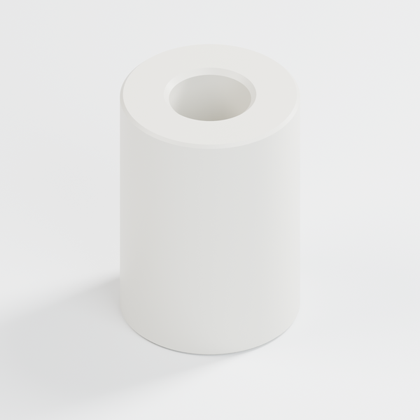](parts/hardware_spacer_m3_nylon_white_7_mm_outer_diameter_10_mm_depth/README.md)
[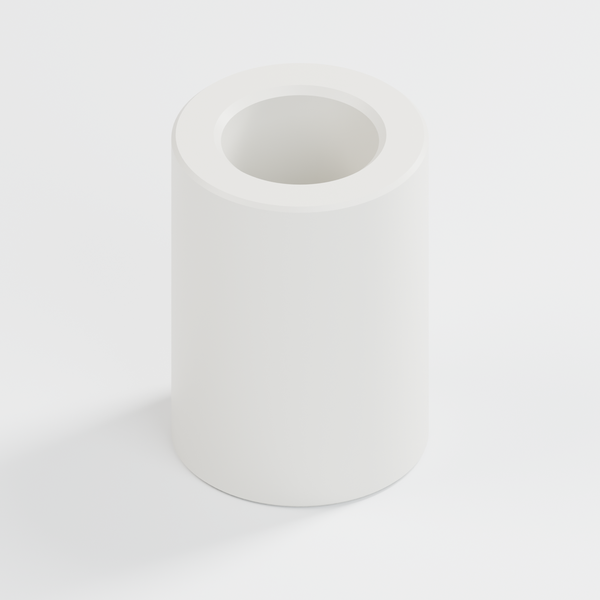](parts/hardware_spacer_m4_nylon_white_7_mm_outer_diameter_10_mm_depth/README.md)
[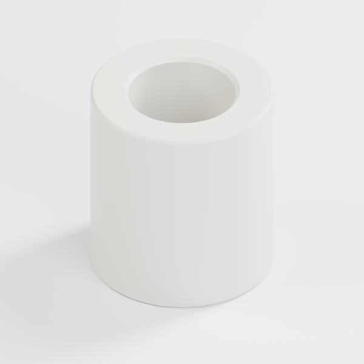](parts/hardware_spacer_m5_nylon_white_9_mm_outer_diameter_10_mm_depth/README.md)
[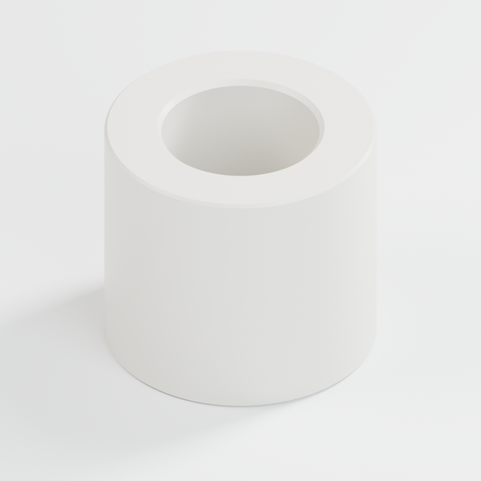](parts/hardware_spacer_m6_nylon_white_11_mm_outer_diameter_10_mm_depth/README.md)
[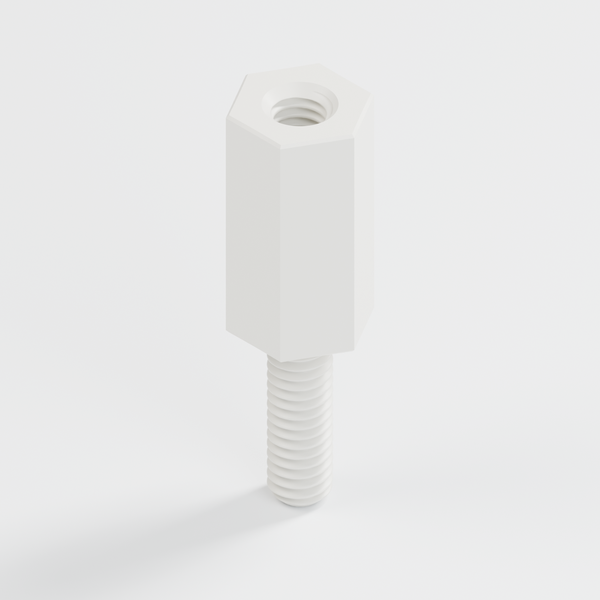](parts/hardware_standoff_m2_5_stud_to_tapped_hexagon_nylon_white_5_mm_across_flats_8_mm_stud_length_10_mm_depth/README.md)
[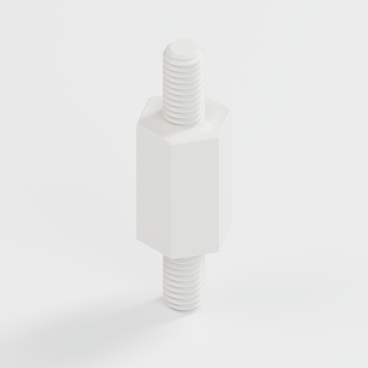](parts/hardware_standoff_m3_stud_to_stud_hexagon_nylon_white_6_mm_across_flats_6_mm_stud_length_10_mm_depth/README.md)
[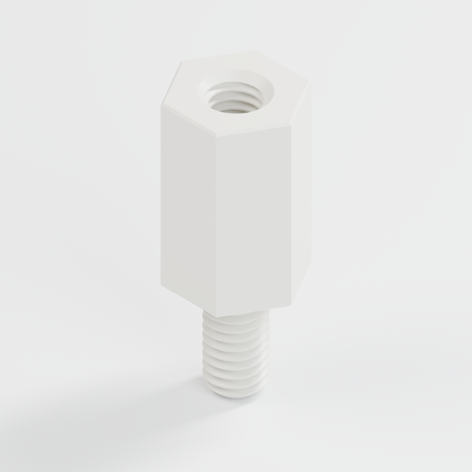](parts/hardware_standoff_m3_stud_to_tapped_hexagon_nylon_white_6_mm_across_flats_6_mm_stud_length_10_mm_depth/README.md)
[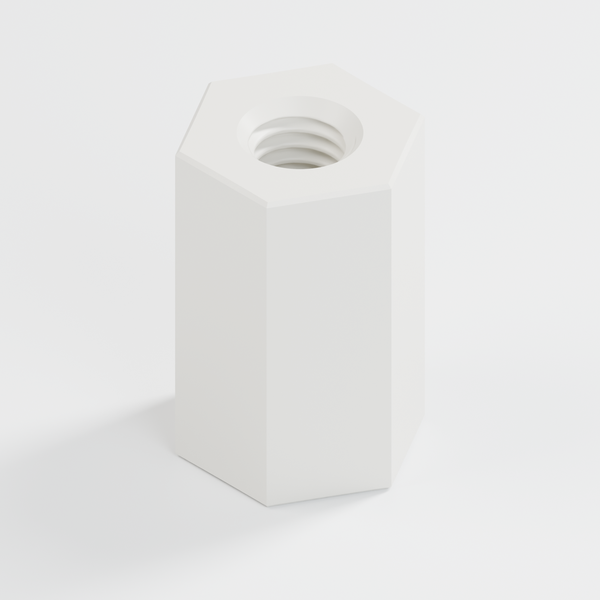](parts/hardware_standoff_m3_tapped_to_tapped_hexagon_nylon_white_6_mm_across_flats_10_mm_depth/README.md)
[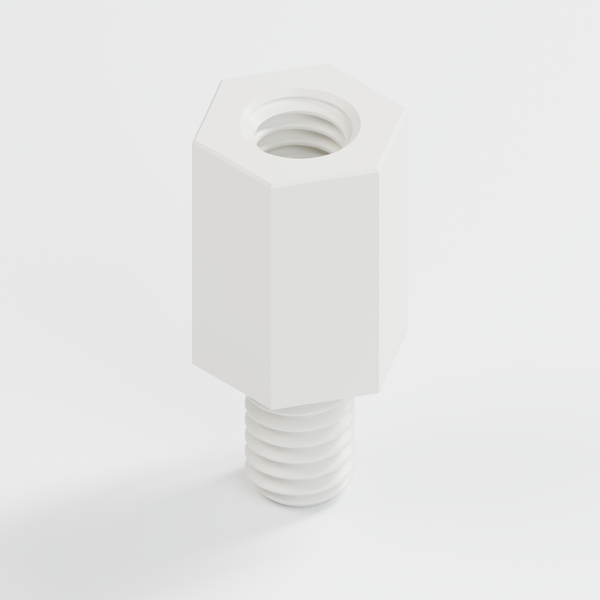](parts/hardware_standoff_m4_stud_to_tapped_hexagon_nylon_white_7_mm_across_flats_6_mm_stud_length_10_mm_depth/README.md)
[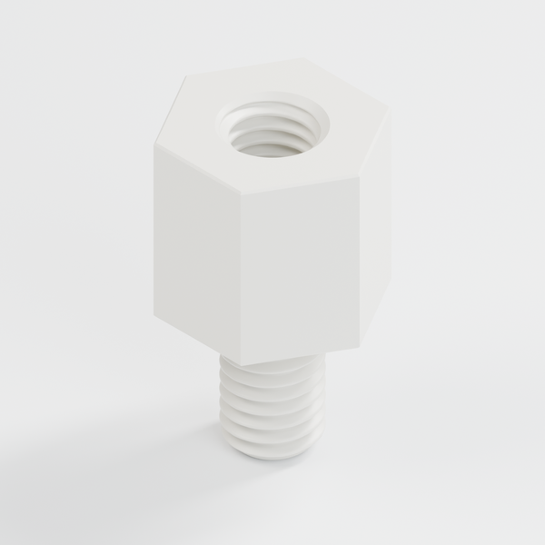](parts/hardware_standoff_m5_stud_to_tapped_hexagon_nylon_white_10_mm_across_flats_8_mm_stud_length_10_mm_depth/README.md)
[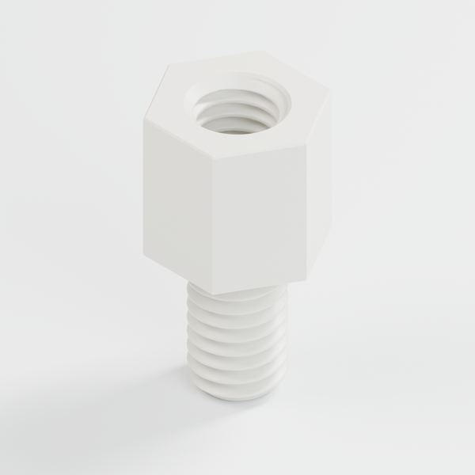](parts/hardware_standoff_m6_stud_to_tapped_hexagon_nylon_white_10_mm_across_flats_10_mm_stud_length_10_mm_depth/README.md)

Representative 10 mm parts rendered from the actual full-detail geometry in Blender/Cycles, using the bolt catalogue's softbox studio and natural white nylon material. These are reference renders, not photographs; images are not to a common scale.

## Details

The catalogue contains **157 part records**. Round spacers use one outside-diameter series per screw size: **M3: 7 mm; M4: 7 mm; M5: 9 mm; M6: 11 mm**. Their plain clearance bores are **3.2, 4.3, 5.3 and 6.4 mm**, respectively. Hex standoffs use **M2.5 x 0.45, M3 x 0.5, M4 x 0.7, M5 x 0.8 and M6 x 1 threads**, with one hex-body and stud-length series per size as listed below. Both families are white nylon.

These are generic catalogue models. Tapped-to-tapped models use a continuous through thread. Stud-to-tapped models have one stud and an assumed blind tapped cavity, limited to body depth minus 1 mm. Stud-to-stud models have two studs and a solid body. Stud length is 8 mm for M2.5, 6 mm for M3/M4, 8 mm for M5 and 10 mm for M6. Stud length is additional to body depth. Bought parts can have different tapping depths and construction; the matching depth ranges are catalogue choices, not a claim that every variant is stocked. Small chamfers and the nylon finish are visual approximations. [Dimension evidence and assumptions](source_file/dimension/README.md) distinguish confirmed supplier dimensions from catalogue choices.

## Parts

| Family | Body depths (mm) | Browse |
| --- | --- | --- |
| Round M3 clearance spacer, 7 mm OD / 3.2 mm bore | 3, 5, 6, 8, 10, 12, 15 | [M3 spacers](navigation_oobb/hardware/spacer/m3/README.md) |
| Round M4 clearance spacer, 7 mm OD / 4.3 mm bore | 3, 5, 6, 8, 10, 12, 15, 20, 25, 30 | [M4 spacers](navigation_oobb/hardware/spacer/m4/README.md) |
| Round M5 clearance spacer, 9 mm OD / 5.3 mm bore | 3, 5, 6, 8, 10, 12, 15, 20, 25, 30 | [M5 spacers](navigation_oobb/hardware/spacer/m5/README.md) |
| Round M6 clearance spacer, 11 mm OD / 6.4 mm bore | 3, 5, 6, 8, 10, 12, 15, 20, 25, 30 | [M6 spacers](navigation_oobb/hardware/spacer/m6/README.md) |
| M2.5 tapped to tapped hex standoff, 5 mm A/F | 6, 8, 10, 12, 15, 20, 25, 30 | [tapped_to_tapped](navigation_oobb/hardware/standoff/m2_5/tapped_to_tapped/README.md) |
| M2.5 stud to tapped hex standoff, 5 mm A/F, 8 mm studs | 6, 8, 10, 12, 15, 20, 25, 30 | [stud_to_tapped](navigation_oobb/hardware/standoff/m2_5/stud_to_tapped/README.md) |
| M2.5 stud to stud hex standoff, 5 mm A/F, 8 mm studs | 6, 8, 10, 12, 15, 20, 25, 30 | [stud_to_stud](navigation_oobb/hardware/standoff/m2_5/stud_to_stud/README.md) |
| M3 tapped to tapped hex standoff, 6 mm A/F | 6, 8, 10, 12, 15, 20, 25, 30 | [tapped_to_tapped](navigation_oobb/hardware/standoff/m3/tapped_to_tapped/README.md) |
| M3 stud to tapped hex standoff, 6 mm A/F, 6 mm studs | 6, 8, 10, 12, 15, 20, 25, 30 | [stud_to_tapped](navigation_oobb/hardware/standoff/m3/stud_to_tapped/README.md) |
| M3 stud to stud hex standoff, 6 mm A/F, 6 mm studs | 6, 8, 10, 12, 15, 20, 25, 30 | [stud_to_stud](navigation_oobb/hardware/standoff/m3/stud_to_stud/README.md) |
| M4 tapped to tapped hex standoff, 7 mm A/F | 6, 8, 10, 12, 15, 20, 25, 30 | [tapped_to_tapped](navigation_oobb/hardware/standoff/m4/tapped_to_tapped/README.md) |
| M4 stud to tapped hex standoff, 7 mm A/F, 6 mm studs | 6, 8, 10, 12, 15, 20, 25, 30 | [stud_to_tapped](navigation_oobb/hardware/standoff/m4/stud_to_tapped/README.md) |
| M4 stud to stud hex standoff, 7 mm A/F, 6 mm studs | 6, 8, 10, 12, 15, 20, 25, 30 | [stud_to_stud](navigation_oobb/hardware/standoff/m4/stud_to_stud/README.md) |
| M5 tapped to tapped hex standoff, 10 mm A/F | 6, 8, 10, 12, 15, 20, 25, 30 | [tapped_to_tapped](navigation_oobb/hardware/standoff/m5/tapped_to_tapped/README.md) |
| M5 stud to tapped hex standoff, 10 mm A/F, 8 mm studs | 6, 8, 10, 12, 15, 20, 25, 30 | [stud_to_tapped](navigation_oobb/hardware/standoff/m5/stud_to_tapped/README.md) |
| M5 stud to stud hex standoff, 10 mm A/F, 8 mm studs | 6, 8, 10, 12, 15, 20, 25, 30 | [stud_to_stud](navigation_oobb/hardware/standoff/m5/stud_to_stud/README.md) |
| M6 tapped to tapped hex standoff, 10 mm A/F | 6, 8, 10, 12, 15, 20, 25, 30 | [tapped_to_tapped](navigation_oobb/hardware/standoff/m6/tapped_to_tapped/README.md) |
| M6 stud to tapped hex standoff, 10 mm A/F, 10 mm studs | 6, 8, 10, 12, 15, 20, 25, 30 | [stud_to_tapped](navigation_oobb/hardware/standoff/m6/stud_to_tapped/README.md) |
| M6 stud to stud hex standoff, 10 mm A/F, 10 mm studs | 6, 8, 10, 12, 15, 20, 25, 30 | [stud_to_stud](navigation_oobb/hardware/standoff/m6/stud_to_stud/README.md) |

Navigation follows hardware / family / nominal screw size / variant and material / body size / stud length (where present) / body depth. Depths sort numerically. Part pages link SVG/PDF drawings, STL/GLB models, editable OpenSCAD, Blender scenes, drawer labels and YAML metadata. STL and SCAD use millimetres; GLB uses metres.

[Other OOMP catalogues](https://github.com/oomlout/oomlout_oomp_version_5) | [Bolt catalogue reference](https://github.com/oomlout/oomp_hardware_bolt_version_5)

## Assembly

Choose the required separation and distinguish a plain spacer from a threaded standoff. Confirm actual bore, thread engagement and supplier construction against the selected purchased part; this catalogue does not prescribe a torque or a tested assembly procedure.

For editing declarations and running the pipeline, see the [generator guide](README_GENERATOR.md).
