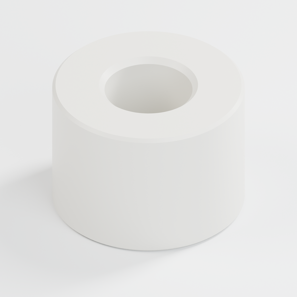
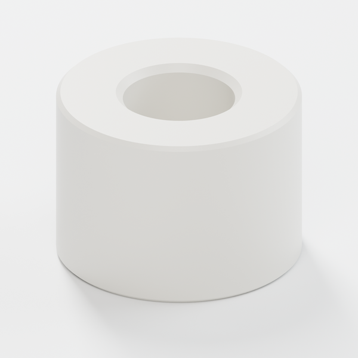
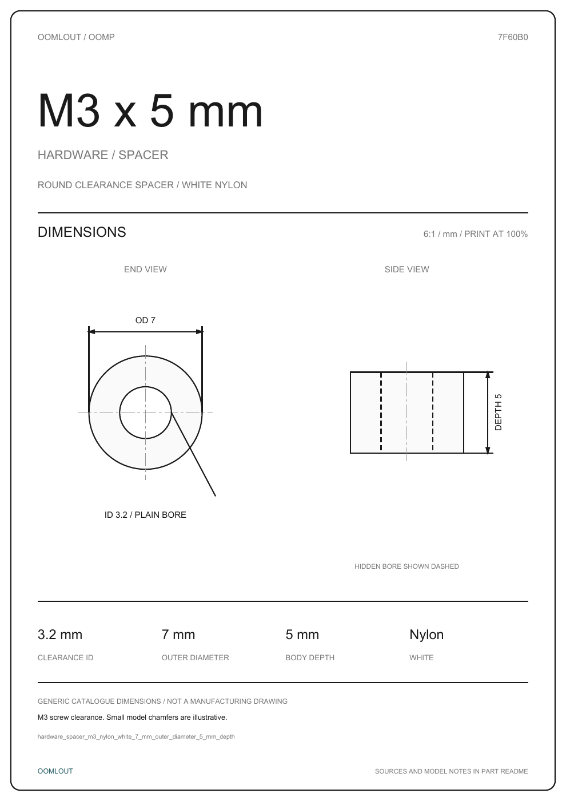

<!-- hardware-part:start -->
# M3 x 5 mm round spacer

## Summary

White nylon spacing hardware for M3 assemblies.

[Catalogue overview](../../README.md) | [Browse family](../../navigation_oobb/hardware/spacer/README.md)

<a href="three_d_model/readme_isometric.png"></a>
<a href="three_d_model/readme_product.png"></a>
<a href="working_mechanical_drawing.png"></a>

Blender/Cycles reference renders from the saved CAD geometry; not product photographs.

## Details

**OOMP ID:** `hardware_spacer_m3_nylon_white_7_mm_outer_diameter_5_mm_depth`

**Taxonomy:** hardware / spacer / m3 / nylon_white / 7_mm_outer_diameter / 5_mm_depth

| Dimension | Value |
| --- | --- |
| Body depth | 5 mm |
| Material / colour | Nylon / white |
| Plain clearance bore | 3.2 mm |
| Outer diameter | 7 mm |


**Model basis:** Generic catalogue dimensions; not a manufacturer-specific drawing. M3 denotes screw compatibility; the plain clearance bore is 3.2 mm, not a thread.

Small edge chamfers and material appearance are illustrative. Dimensions are nominal, with no supplier tolerances assigned. The full standoff mesh includes a helical basic thread; the display mesh uses smooth tapped bores and studs.

Source evidence checked 2026-11-16:

- [Soundtronics clearance spacer catalogue](https://www.soundtronics.co.uk/fixings-and-hardware/): Lists 3.2 mm bore, 7 mm OD nylon spacers at 3, 5 and 8 mm depths. Supports this bore/OD combination, not every depth or a certified white nylon grade.
- [Siqma 10 mm unthreaded nylon spacer](https://store.siqma.com/plastic-10mm-unthreaded-nylon-spacer-abs.html): Product search listing describes 10 mm length, 7 mm OD and 3.2 mm ID. Listing is dimensional context only; no manufacturer tolerance or grade is adopted.
- [VXB M3 round spacer assortment](https://vxb.com/products/dope-250-pack-black-nylon-round-spacer-set-3mm-id): Lists common 7 mm OD spacer depths including 3, 6, 8, 10, 12 and 15 mm. This source is black nylon with a stated 3 mm bore; it supports depth selection only, not this catalogue's white finish or 3.2 mm bore.

## Parts

- [OOMP metadata](working.yaml)
- [Dimensioned SVG](working_mechanical_drawing.svg)
- [A4 dimensioned PDF](working_mechanical_drawing.pdf)
- [Drawer label SVG](label_oomp.svg)
- [Editable OpenSCAD](scad/working.scad)
- [OpenSCAD STL](scad/working.stl)
- [Full STL](three_d_model/model_full.stl)
- [Display STL](three_d_model/model_display.stl)
- [Full GLB](three_d_model/model_full.glb)
- [Display GLB](three_d_model/model_display.glb)
- [Blender studio scene](three_d_model/studio.blend)
- [Editable model recipe](three_d_model/parameters.json)
- [Per-part model rebuild](three_d_model/model.py)
- [Model assumptions](three_d_model/model_notes.md)
- [Lighting and render provenance](three_d_model/render_scene.json)

These formats describe the same part. STL/SCAD units are millimetres; GLB units are metres with Y up. The [part folder](./) contains all generated assets.

<details>
<summary>Complete OOMP metadata</summary>

```yaml
bore_mm: 3.2
colour: white
depth_mm: 5
dimension_note: M3 denotes screw compatibility; the plain clearance bore is 3.2 mm,
  not a thread.
dimension_status: Generic catalogue dimensions; not a manufacturer-specific drawing.
material: nylon
nominal_size: m3
oobb_details:
  across_flats_mm: 6
  angular_segments: 96
  bore_mm: 3.2
  characteristic_dimension_basis: Maximum overall length or nominal outside width
  characteristic_dimension_mm: 7
  connection_type: plain
  depth_mm: 5
  edge_chamfer_mm: 0.12
  family: spacer
  finish: nylon_white
  mouth_chamfer_mm: 0.2
  oobb_name: spacer
  oobb_type: spacer
  outer_diameter_mm: 7
  overall_length_mm: 5
  run_scad: true
  run_solidcraft: false
  samples_per_pitch: 16
  specification: Generic catalogue geometry
  stud_length_mm: 0
  tapped_depth_mm: 0
  thread_model: none
  thread_nominal_diameter_mm: 3
  thread_pitch_mm: 0.5
oobb_type: spacer
outer_diameter_mm: 7
shape: round
source_refs:
- soundtronics_spacers
- siqma_spacer_10
- vxb_spacer_depths
svg_details:
  accent: '#245b61'
  dimension_font_mm: 3.2
  filename: working_mechanical_drawing
  font_family: DejaVu Sans
  ink: '#1a1a1a'
  line_width_mm: 0.45
  muted: '#777777'
  sheet_height_mm: 297
  sheet_width_mm: 210
  svg_name: spacer_standoff_drawing
  view_scale: 6
taxonomy_1: hardware
taxonomy_10: ''
taxonomy_11: ''
taxonomy_12: ''
taxonomy_13: ''
taxonomy_14: ''
taxonomy_15: ''
taxonomy_2: spacer
taxonomy_3: m3
taxonomy_4: nylon_white
taxonomy_5: 7_mm_outer_diameter
taxonomy_6: 5_mm_depth
taxonomy_7: ''
taxonomy_8: ''
taxonomy_9: ''
threaded: false
three_d_model:
  generator: spacer_model_geometry
  material:
    base_colour_srgb:
    - 0.86
    - 0.85
    - 0.81
    coat_roughness: 0.28
    coat_weight: 0.025
    metallic: 0.0
    microtexture_height_um: 0.4
    microtexture_spacing_mm: 0.025
    name: Natural white nylon
    note: Visual natural nylon approximation; exact polymer grade and mould surface
      not supplied by catalogue.
    roughness: 0.38
    roughness_variation: 0.025
  notes:
  - Generic catalogue dimensions; not a manufacturer-specific drawing.
  - M3 denotes screw compatibility; the plain clearance bore is 3.2 mm, not a thread.
  - Small edge and mouth chamfers are illustrative assumptions, not measured supplier
    features.
  - Full standoff models have helical basic M3 profiles; display models use smooth
    minor-diameter tapped bores and major-diameter studs.
  - STL is in millimetres. GLB is in metres with Y up. OpenSCAD is in millimetres.
  parameters:
    across_flats_mm: 6
    angular_segments: 96
    bore_mm: 3.2
    characteristic_dimension_basis: Maximum overall length or nominal outside width
    characteristic_dimension_mm: 7
    connection_type: plain
    depth_mm: 5
    edge_chamfer_mm: 0.12
    family: spacer
    finish: nylon_white
    mouth_chamfer_mm: 0.2
    outer_diameter_mm: 7
    overall_length_mm: 5
    samples_per_pitch: 16
    specification: Generic catalogue geometry
    stud_length_mm: 0
    tapped_depth_mm: 0
    thread_model: none
    thread_nominal_diameter_mm: 3
    thread_pitch_mm: 0.5
  renders:
    high:
      file: render_high.png
      pixels: 1600
      variant: full
      view: isometric
    low:
      file: render_low.png
      pixels: 512
      variant: display
      view: isometric
    product_high:
      file: render_product_high.png
      pixels: 1600
      variant: full
      view: product
    product_low:
      file: render_product_low.png
      pixels: 512
      variant: display
      view: product
  schema_version: 1
  studio:
    adaptive_threshold: 0.015
    denoise: true
    device: auto
    engine: cycles
    exposure: 0.0
    floor_colour_srgb:
    - 0.93
    - 0.935
    - 0.94
    floor_roughness: 0.55
    framing_margin: 0.13
    high_samples: 96
    lights:
    - colour:
      - 1.0
      - 0.96
      - 0.9
      height: 5.0
      name: Key softbox
      position:
      - -3
      - -4
      - 6
      power: 650.0
      width: 4.0
    - colour:
      - 0.9
      - 0.95
      - 1.0
      height: 4.0
      name: Fill softbox
      position:
      - 4
      - -1
      - 3
      power: 330.0
      width: 3.0
    - colour:
      - 1.0
      - 1.0
      - 1.0
      height: 5.0
      name: Rim strip
      position:
      - 1
      - 4
      - 4
      power: 850.0
      width: 1.2
    look: AgX - Medium High Contrast
    low_samples: 48
    poses:
      isometric:
        camera_eye:
        - 1
        - -1
        - 1
        orientation: principal axis Z up
        projection: orthographic
      product:
        camera_eye:
        - -6
        - -10
        - 6
        orientation: resting on lower face, bore visible
        projection: orthographic
        resting_axis: face
        support: Stable convex-hull support using actual mesh centre of mass.
        yaw_degrees: -12.0
    seed: 7991
    view_transform: AgX
    world_colour:
    - 0.78
    - 0.82
    - 0.9
    world_strength: 0.35
taxonomy_1_upper: HARDWARE
taxonomy_1_upper_length_1: H
taxonomy_1_upper_length_2: HA
taxonomy_1_upper_length_3: HAR
taxonomy_1_upper_length_4: HARD
taxonomy_1_upper_length_5: HARDW
taxonomy_1_length_1: h
taxonomy_1_length_2: ha
taxonomy_1_length_3: har
taxonomy_1_length_4: hard
taxonomy_1_length_5: hardw
taxonomy_1_capital: Hardware
taxonomy_1_first_letter: h
taxonomy_1_first_letter_upper: H
taxonomy_2_upper: SPACER
taxonomy_2_upper_length_1: S
taxonomy_2_upper_length_2: SP
taxonomy_2_upper_length_3: SPA
taxonomy_2_upper_length_4: SPAC
taxonomy_2_upper_length_5: SPACE
taxonomy_2_length_1: s
taxonomy_2_length_2: sp
taxonomy_2_length_3: spa
taxonomy_2_length_4: spac
taxonomy_2_length_5: space
taxonomy_2_capital: Spacer
taxonomy_2_first_letter: s
taxonomy_2_first_letter_upper: S
taxonomy_3_upper: M3
taxonomy_3_upper_length_1: M
taxonomy_3_upper_length_2: M3
taxonomy_3_upper_length_3: M3
taxonomy_3_upper_length_4: M3
taxonomy_3_upper_length_5: M3
taxonomy_3_length_1: m
taxonomy_3_length_2: m3
taxonomy_3_length_3: m3
taxonomy_3_length_4: m3
taxonomy_3_length_5: m3
taxonomy_3_capital: M3
taxonomy_3_first_letter: m
taxonomy_3_first_letter_upper: M
taxonomy_4_upper: NYLON_WHITE
taxonomy_4_upper_length_1: N
taxonomy_4_upper_length_2: NY
taxonomy_4_upper_length_3: NYL
taxonomy_4_upper_length_4: NYLO
taxonomy_4_upper_length_5: NYLON
taxonomy_4_length_1: n
taxonomy_4_length_2: ny
taxonomy_4_length_3: nyl
taxonomy_4_length_4: nylo
taxonomy_4_length_5: nylon
taxonomy_4_capital: Nylon White
taxonomy_4_first_letter: n
taxonomy_4_first_letter_upper: N
taxonomy_5_upper: 7_MM_OUTER_DIAMETER
taxonomy_5_upper_length_1: '7'
taxonomy_5_upper_length_2: '7_'
taxonomy_5_upper_length_3: 7_M
taxonomy_5_upper_length_4: 7_MM
taxonomy_5_upper_length_5: 7_MM_
taxonomy_5_length_1: '7'
taxonomy_5_length_2: '7_'
taxonomy_5_length_3: 7_m
taxonomy_5_length_4: 7_mm
taxonomy_5_length_5: 7_mm_
taxonomy_5_capital: 7 mm Outer Diameter
taxonomy_5_first_letter: '7'
taxonomy_5_first_letter_upper: '7'
taxonomy_6_upper: 5_MM_DEPTH
taxonomy_6_upper_length_1: '5'
taxonomy_6_upper_length_2: '5_'
taxonomy_6_upper_length_3: 5_M
taxonomy_6_upper_length_4: 5_MM
taxonomy_6_upper_length_5: 5_MM_
taxonomy_6_length_1: '5'
taxonomy_6_length_2: '5_'
taxonomy_6_length_3: 5_m
taxonomy_6_length_4: 5_mm
taxonomy_6_length_5: 5_mm_
taxonomy_6_capital: 5 mm Depth
taxonomy_6_first_letter: '5'
taxonomy_6_first_letter_upper: '5'
id: hardware_spacer_m3_nylon_white_7_mm_outer_diameter_5_mm_depth
id_no_class: hardware_spacer_m3_nylon_white_7_mm_outer_diameter_5_mm_depth
id_no_type: hardware_spacer_m3_nylon_white_7_mm_outer_diameter_5_mm_depth
id_no_size: hardware_spacer_m3_nylon_white_7_mm_outer_diameter_5_mm_depth
oomp_key: oomp_hardware_spacer_m3_nylon_white_7_mm_outer_diameter_5_mm_depth
link_github: https://github.com/oomlout/oomp_hardware_spacer_standoff_version_5/tree/main/parts/hardware_spacer_m3_nylon_white_7_mm_outer_diameter_5_mm_depth
link_main: https://github.com/oomlout/oomp_hardware_spacer_standoff_version_5/tree/main/parts/hardware_spacer_m3_nylon_white_7_mm_outer_diameter_5_mm_depth
link_redirect: https://github.com/oomlout/oomp_hardware_spacer_standoff_version_5/tree/main/parts/hardware_spacer_m3_nylon_white_7_mm_outer_diameter_5_mm_depth
directory: parts/hardware_spacer_m3_nylon_white_7_mm_outer_diameter_5_mm_depth
name: hardware_spacer_m3_nylon_white_7_mm_outer_diameter_5_mm_depth
name_no_class: Hardware Spacer M3 Nylon White 7 Mm Outer Diameter 5 Mm Depth
name_no_type: Hardware Spacer M3 Nylon White 7 Mm Outer Diameter 5 Mm Depth
name_no_size: Hardware Spacer M3 Nylon White 7 Mm Outer Diameter 5 Mm Depth
md5: 7f60b0aa3222c35b1e74b8d75ee9973f
md5_5: 7f60b
md5_5_upper: 7F60B
md5_6: 7f60b0
md5_6_upper: 7F60B0
md5_6_alpha: 4yx80
md5_6_alpha_upper: 4YX80
md5_10: 7f60b0aa32
md5_10_upper: 7F60B0AA32
bip_39_full_array:
- legal
- airport
- clever
- gold
- club
- pulse
- keep
- novel
- struggle
- warrior
- grape
- leisure
bip_39_full_space: legal airport clever gold club pulse keep novel struggle warrior
  grape leisure
bip_39_full_no_space: legalairportclevergoldclubpulsekeepnovelstrugglewarriorgrapeleisure
bip_39_full_underscore: legal_airport_clever_gold_club_pulse_keep_novel_struggle_warrior_grape_leisure
bip_39_2_word_array:
- legal
- airport
bip_39_2_word_space: legal airport
bip_39_2_word_no_space: legalairport
bip_39_2_word_underscore: legal_airport
bip_39_3_word_array:
- legal
- airport
- clever
bip_39_3_word_space: legal airport clever
bip_39_3_word_no_space: legalairportclever
bip_39_3_word_underscore: legal_airport_clever
name_space: hardware spacer m3 nylon white 7 mm outer diameter 5 mm depth
name_proper: Hardware Spacer M3 Nylon White 7 Mm Outer Diameter 5 Mm Depth
```

</details>

## Assembly

Select the depth required by the assembly. Match the nominal screw size and check the purchased part's actual clearance or usable thread engagement. No tested assembly procedure or tightening torque has been established for this generic record.
<!-- hardware-part:end -->
