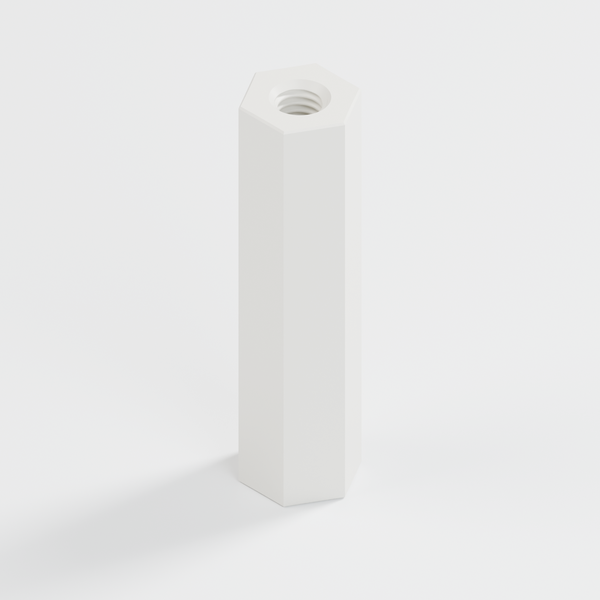
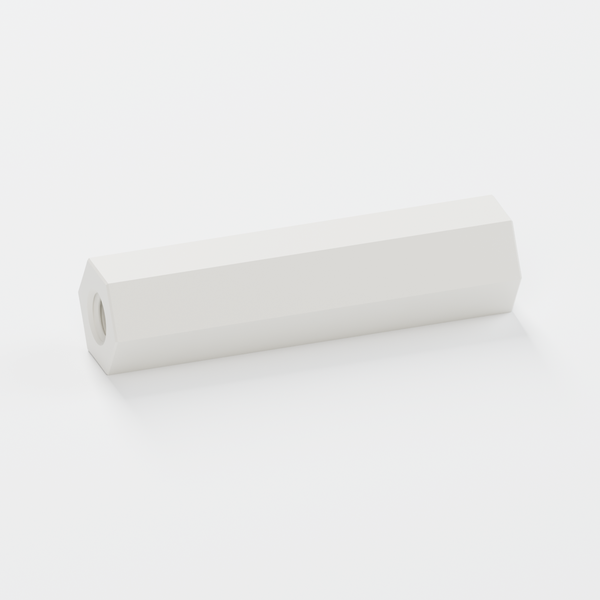
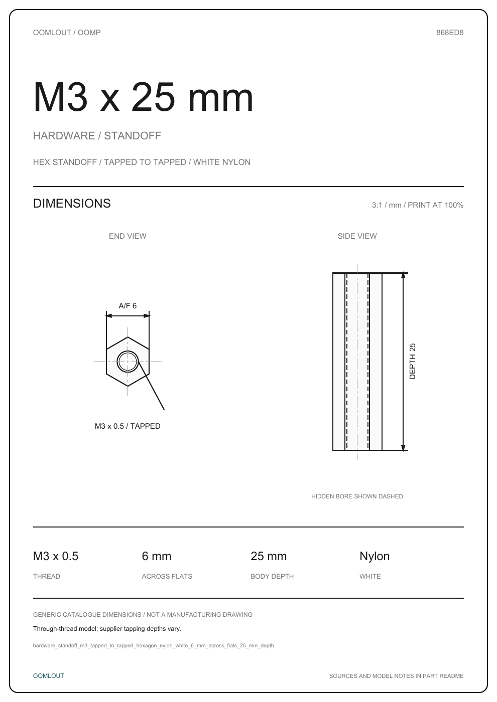

<!-- hardware-part:start -->
# M3 x 25 mm tapped to tapped hex standoff

## Summary

White nylon spacing hardware for M3 assemblies.

[Catalogue overview](../../README.md) | [Browse family](../../navigation_oobb/hardware/standoff/README.md)

<a href="three_d_model/readme_isometric.png"></a>
<a href="three_d_model/readme_product.png"></a>
<a href="working_mechanical_drawing.png"></a>

Blender/Cycles reference renders from the saved CAD geometry; not product photographs.

## Details

**OOMP ID:** `hardware_standoff_m3_tapped_to_tapped_hexagon_nylon_white_6_mm_across_flats_25_mm_depth`

**Taxonomy:** hardware / standoff / m3 / tapped_to_tapped / hexagon / nylon_white / 6_mm_across_flats / 25_mm_depth

| Dimension | Value |
| --- | --- |
| Body depth | 25 mm |
| Material / colour | Nylon / white |
| Thread, both ends | M3 x 0.5 |
| Across flats | 6 mm |
| Connection | tapped_to_tapped |
| Modelled thread construction | through |
| Stud length, each | 0 mm |
| Modelled tapped depth | 25 mm |
| Overall length | 25 mm |


**Model basis:** Generic catalogue dimensions; not a manufacturer-specific drawing. Model assumes a continuous M3 x 0.5 through thread. Supplier tapping depth and blind/through construction vary.

Small edge chamfers and material appearance are illustrative. Dimensions are nominal, with no supplier tolerances assigned. The full standoff mesh includes a helical basic thread; the display mesh uses smooth tapped bores and studs.

Source evidence checked 2026-11-16:

- [CQRobot white nylon M3 tapped-to-tapped hex standoffs](https://cqrobot.com/product/PZSJGJ023): White nylon M3 tapped-to-tapped family with 6, 10, 15, 20 and 30 mm options. Does not establish tapping depth or the across-flats value used here.
- [Lyn-Tron metric tapped-to-tapped hex standoffs](https://www.lyntron.com/female-female-standoff?outsideDiameter%5B%5D=6.0&profile%5B%5D=hexagon&showMore=true&unitOfMeasurement%5B%5D=metric): Includes nylon 6 mm hex tapped-to-tapped hardware and M3 x 0.5 threads. Generic family evidence, not a claim that every selected depth is an exact matched SKU.
- [Wurth 970060365 dimensional sheet](https://www.we-online.com/components/products/datasheet/970060365.pdf): M3 tapped-to-tapped geometry, 6 mm across flats and 6 mm body depth. Black polyamide example; used for dimensional context, not white material identity.
- [Wurth 970300365 dimensional sheet](https://www.we-online.com/components/products/datasheet/970300365.pdf): 30 mm M3 tapped-to-tapped example, 6 mm across flats, with 10 mm tapping at each end. Demonstrates why a generic continuous through-thread model must not imply a supplier's tapping depth.

## Parts

- [OOMP metadata](working.yaml)
- [Dimensioned SVG](working_mechanical_drawing.svg)
- [A4 dimensioned PDF](working_mechanical_drawing.pdf)
- [Drawer label SVG](label_oomp.svg)
- [Editable OpenSCAD](scad/working.scad)
- [OpenSCAD STL](scad/working.stl)
- [Full STL](three_d_model/model_full.stl)
- [Display STL](three_d_model/model_display.stl)
- [Full GLB](three_d_model/model_full.glb)
- [Display GLB](three_d_model/model_display.glb)
- [Blender studio scene](three_d_model/studio.blend)
- [Editable model recipe](three_d_model/parameters.json)
- [Per-part model rebuild](three_d_model/model.py)
- [Model assumptions](three_d_model/model_notes.md)
- [Lighting and render provenance](three_d_model/render_scene.json)

These formats describe the same part. STL/SCAD units are millimetres; GLB units are metres with Y up. The [part folder](./) contains all generated assets.

<details>
<summary>Complete OOMP metadata</summary>

```yaml
across_flats_mm: 6
colour: white
connection_type: tapped_to_tapped
depth_mm: 25
dimension_note: Model assumes a continuous M3 x 0.5 through thread. Supplier tapping
  depth and blind/through construction vary.
dimension_status: Generic catalogue dimensions; not a manufacturer-specific drawing.
material: nylon
nominal_size: m3
oobb_details:
  across_flats_mm: 6
  angular_segments: 96
  bore_mm: 3.2
  characteristic_dimension_basis: Maximum overall length or nominal outside width
  characteristic_dimension_mm: 25
  connection_type: tapped_to_tapped
  depth_mm: 25
  edge_chamfer_mm: 0.12
  family: standoff
  finish: nylon_white
  mouth_chamfer_mm: 0.2
  oobb_name: standoff
  oobb_type: standoff
  outer_diameter_mm: 7
  overall_length_mm: 25
  run_scad: true
  run_solidcraft: false
  samples_per_pitch: 16
  specification: Generic catalogue geometry
  stud_length_mm: 0
  tapped_depth_mm: 25
  thread_model: through
  thread_nominal_diameter_mm: 3
  thread_pitch_mm: 0.5
oobb_type: standoff
overall_length_mm: 25
shape: hexagon
source_refs:
- cqrobot_white_standoffs
- lyntron_hex_standoffs
- wurth_standoff_6
- wurth_standoff_30
stud_length_mm: 0
svg_details:
  accent: '#245b61'
  dimension_font_mm: 3.2
  filename: working_mechanical_drawing
  font_family: DejaVu Sans
  ink: '#1a1a1a'
  line_width_mm: 0.45
  muted: '#777777'
  sheet_height_mm: 297
  sheet_width_mm: 210
  svg_name: spacer_standoff_drawing
  view_scale: 3
tapped_depth_mm: 25
taxonomy_1: hardware
taxonomy_10: ''
taxonomy_11: ''
taxonomy_12: ''
taxonomy_13: ''
taxonomy_14: ''
taxonomy_15: ''
taxonomy_2: standoff
taxonomy_3: m3
taxonomy_4: tapped_to_tapped
taxonomy_5: hexagon
taxonomy_6: nylon_white
taxonomy_7: 6_mm_across_flats
taxonomy_8: 25_mm_depth
taxonomy_9: ''
thread: M3 x 0.5
thread_model: through
thread_nominal_diameter_mm: 3
thread_pitch_mm: 0.5
threaded: true
three_d_model:
  generator: spacer_model_geometry
  material:
    base_colour_srgb:
    - 0.86
    - 0.85
    - 0.81
    coat_roughness: 0.28
    coat_weight: 0.025
    metallic: 0.0
    microtexture_height_um: 0.4
    microtexture_spacing_mm: 0.025
    name: Natural white nylon
    note: Visual natural nylon approximation; exact polymer grade and mould surface
      not supplied by catalogue.
    roughness: 0.38
    roughness_variation: 0.025
  notes:
  - Generic catalogue dimensions; not a manufacturer-specific drawing.
  - Model assumes a continuous M3 x 0.5 through thread. Supplier tapping depth and
    blind/through construction vary.
  - Small edge and mouth chamfers are illustrative assumptions, not measured supplier
    features.
  - Full standoff models have helical basic M3 profiles; display models use smooth
    minor-diameter tapped bores and major-diameter studs.
  - STL is in millimetres. GLB is in metres with Y up. OpenSCAD is in millimetres.
  parameters:
    across_flats_mm: 6
    angular_segments: 96
    bore_mm: 3.2
    characteristic_dimension_basis: Maximum overall length or nominal outside width
    characteristic_dimension_mm: 25
    connection_type: tapped_to_tapped
    depth_mm: 25
    edge_chamfer_mm: 0.12
    family: standoff
    finish: nylon_white
    mouth_chamfer_mm: 0.2
    outer_diameter_mm: 7
    overall_length_mm: 25
    samples_per_pitch: 16
    specification: Generic catalogue geometry
    stud_length_mm: 0
    tapped_depth_mm: 25
    thread_model: through
    thread_nominal_diameter_mm: 3
    thread_pitch_mm: 0.5
  renders:
    high:
      file: render_high.png
      pixels: 1600
      variant: full
      view: isometric
    low:
      file: render_low.png
      pixels: 512
      variant: display
      view: isometric
    product_high:
      file: render_product_high.png
      pixels: 1600
      variant: full
      view: product
    product_low:
      file: render_product_low.png
      pixels: 512
      variant: display
      view: product
  schema_version: 1
  studio:
    adaptive_threshold: 0.015
    denoise: true
    device: auto
    engine: cycles
    exposure: 0.0
    floor_colour_srgb:
    - 0.93
    - 0.935
    - 0.94
    floor_roughness: 0.55
    framing_margin: 0.13
    high_samples: 96
    lights:
    - colour:
      - 1.0
      - 0.96
      - 0.9
      height: 5.0
      name: Key softbox
      position:
      - -3
      - -4
      - 6
      power: 650.0
      width: 4.0
    - colour:
      - 0.9
      - 0.95
      - 1.0
      height: 4.0
      name: Fill softbox
      position:
      - 4
      - -1
      - 3
      power: 330.0
      width: 3.0
    - colour:
      - 1.0
      - 1.0
      - 1.0
      height: 5.0
      name: Rim strip
      position:
      - 1
      - 4
      - 4
      power: 850.0
      width: 1.2
    look: AgX - Medium High Contrast
    low_samples: 48
    poses:
      isometric:
        camera_eye:
        - 1
        - -1
        - 1
        orientation: principal axis Z up
        projection: orthographic
      product:
        camera_eye:
        - -6
        - -10
        - 6
        orientation: lying on side, axial end to left
        projection: orthographic
        resting_axis: side
        support: Stable convex-hull support using actual mesh centre of mass.
        yaw_degrees: -12.0
    seed: 7991
    view_transform: AgX
    world_colour:
    - 0.78
    - 0.82
    - 0.9
    world_strength: 0.35
taxonomy_1_upper: HARDWARE
taxonomy_1_upper_length_1: H
taxonomy_1_upper_length_2: HA
taxonomy_1_upper_length_3: HAR
taxonomy_1_upper_length_4: HARD
taxonomy_1_upper_length_5: HARDW
taxonomy_1_length_1: h
taxonomy_1_length_2: ha
taxonomy_1_length_3: har
taxonomy_1_length_4: hard
taxonomy_1_length_5: hardw
taxonomy_1_capital: Hardware
taxonomy_1_first_letter: h
taxonomy_1_first_letter_upper: H
taxonomy_2_upper: STANDOFF
taxonomy_2_upper_length_1: S
taxonomy_2_upper_length_2: ST
taxonomy_2_upper_length_3: STA
taxonomy_2_upper_length_4: STAN
taxonomy_2_upper_length_5: STAND
taxonomy_2_length_1: s
taxonomy_2_length_2: st
taxonomy_2_length_3: sta
taxonomy_2_length_4: stan
taxonomy_2_length_5: stand
taxonomy_2_capital: Standoff
taxonomy_2_first_letter: s
taxonomy_2_first_letter_upper: S
taxonomy_3_upper: M3
taxonomy_3_upper_length_1: M
taxonomy_3_upper_length_2: M3
taxonomy_3_upper_length_3: M3
taxonomy_3_upper_length_4: M3
taxonomy_3_upper_length_5: M3
taxonomy_3_length_1: m
taxonomy_3_length_2: m3
taxonomy_3_length_3: m3
taxonomy_3_length_4: m3
taxonomy_3_length_5: m3
taxonomy_3_capital: M3
taxonomy_3_first_letter: m
taxonomy_3_first_letter_upper: M
taxonomy_4_upper: TAPPED_TO_TAPPED
taxonomy_4_upper_length_1: T
taxonomy_4_upper_length_2: TA
taxonomy_4_upper_length_3: TAP
taxonomy_4_upper_length_4: TAPP
taxonomy_4_upper_length_5: TAPPE
taxonomy_4_length_1: t
taxonomy_4_length_2: ta
taxonomy_4_length_3: tap
taxonomy_4_length_4: tapp
taxonomy_4_length_5: tappe
taxonomy_4_capital: Tapped To Tapped
taxonomy_4_first_letter: t
taxonomy_4_first_letter_upper: T
taxonomy_5_upper: HEXAGON
taxonomy_5_upper_length_1: H
taxonomy_5_upper_length_2: HE
taxonomy_5_upper_length_3: HEX
taxonomy_5_upper_length_4: HEXA
taxonomy_5_upper_length_5: HEXAG
taxonomy_5_length_1: h
taxonomy_5_length_2: he
taxonomy_5_length_3: hex
taxonomy_5_length_4: hexa
taxonomy_5_length_5: hexag
taxonomy_5_capital: Hexagon
taxonomy_5_first_letter: h
taxonomy_5_first_letter_upper: H
taxonomy_6_upper: NYLON_WHITE
taxonomy_6_upper_length_1: N
taxonomy_6_upper_length_2: NY
taxonomy_6_upper_length_3: NYL
taxonomy_6_upper_length_4: NYLO
taxonomy_6_upper_length_5: NYLON
taxonomy_6_length_1: n
taxonomy_6_length_2: ny
taxonomy_6_length_3: nyl
taxonomy_6_length_4: nylo
taxonomy_6_length_5: nylon
taxonomy_6_capital: Nylon White
taxonomy_6_first_letter: n
taxonomy_6_first_letter_upper: N
taxonomy_7_upper: 6_MM_ACROSS_FLATS
taxonomy_7_upper_length_1: '6'
taxonomy_7_upper_length_2: '6_'
taxonomy_7_upper_length_3: 6_M
taxonomy_7_upper_length_4: 6_MM
taxonomy_7_upper_length_5: 6_MM_
taxonomy_7_length_1: '6'
taxonomy_7_length_2: '6_'
taxonomy_7_length_3: 6_m
taxonomy_7_length_4: 6_mm
taxonomy_7_length_5: 6_mm_
taxonomy_7_capital: 6 mm Across Flats
taxonomy_7_first_letter: '6'
taxonomy_7_first_letter_upper: '6'
taxonomy_8_upper: 25_MM_DEPTH
taxonomy_8_upper_length_1: '2'
taxonomy_8_upper_length_2: '25'
taxonomy_8_upper_length_3: '25_'
taxonomy_8_upper_length_4: 25_M
taxonomy_8_upper_length_5: 25_MM
taxonomy_8_length_1: '2'
taxonomy_8_length_2: '25'
taxonomy_8_length_3: '25_'
taxonomy_8_length_4: 25_m
taxonomy_8_length_5: 25_mm
taxonomy_8_capital: 25 mm Depth
taxonomy_8_first_letter: '2'
taxonomy_8_first_letter_upper: '2'
id: hardware_standoff_m3_tapped_to_tapped_hexagon_nylon_white_6_mm_across_flats_25_mm_depth
id_no_class: hardware_standoff_m3_tapped_to_tapped_hexagon_nylon_white_6_mm_across_flats_25_mm_depth
id_no_type: hardware_standoff_m3_tapped_to_tapped_hexagon_nylon_white_6_mm_across_flats_25_mm_depth
id_no_size: hardware_standoff_m3_tapped_to_tapped_hexagon_nylon_white_6_mm_across_flats_25_mm_depth
oomp_key: oomp_hardware_standoff_m3_tapped_to_tapped_hexagon_nylon_white_6_mm_across_flats_25_mm_depth
link_github: https://github.com/oomlout/oomp_hardware_spacer_standoff_version_5/tree/main/parts/hardware_standoff_m3_tapped_to_tapped_hexagon_nylon_white_6_mm_across_flats_25_mm_depth
link_main: https://github.com/oomlout/oomp_hardware_spacer_standoff_version_5/tree/main/parts/hardware_standoff_m3_tapped_to_tapped_hexagon_nylon_white_6_mm_across_flats_25_mm_depth
link_redirect: https://github.com/oomlout/oomp_hardware_spacer_standoff_version_5/tree/main/parts/hardware_standoff_m3_tapped_to_tapped_hexagon_nylon_white_6_mm_across_flats_25_mm_depth
directory: parts/hardware_standoff_m3_tapped_to_tapped_hexagon_nylon_white_6_mm_across_flats_25_mm_depth
name: hardware_standoff_m3_tapped_to_tapped_hexagon_nylon_white_6_mm_across_flats_25_mm_depth
name_no_class: Hardware Standoff M3 Tapped To Tapped Hexagon Nylon White 6 Mm Across
  Flats 25 Mm Depth
name_no_type: Hardware Standoff M3 Tapped To Tapped Hexagon Nylon White 6 Mm Across
  Flats 25 Mm Depth
name_no_size: Hardware Standoff M3 Tapped To Tapped Hexagon Nylon White 6 Mm Across
  Flats 25 Mm Depth
md5: 868ed818e135e06a14dc73f3cffb888c
md5_5: 868ed
md5_5_upper: 868ED
md5_6: 868ed8
md5_6_upper: 868ED8
md5_6_alpha: 590bc
md5_6_alpha_upper: 590BC
md5_10: 868ed818e1
md5_10_upper: 868ED818E1
bip_39_full_array:
- make
- item
- alert
- second
- fun
- crush
- fat
- mobile
- video
- lemon
- timber
- boring
bip_39_full_space: make item alert second fun crush fat mobile video lemon timber
  boring
bip_39_full_no_space: makeitemalertsecondfuncrushfatmobilevideolemontimberboring
bip_39_full_underscore: make_item_alert_second_fun_crush_fat_mobile_video_lemon_timber_boring
bip_39_2_word_array:
- make
- item
bip_39_2_word_space: make item
bip_39_2_word_no_space: makeitem
bip_39_2_word_underscore: make_item
bip_39_3_word_array:
- make
- item
- alert
bip_39_3_word_space: make item alert
bip_39_3_word_no_space: makeitemalert
bip_39_3_word_underscore: make_item_alert
name_space: hardware standoff m3 tapped to tapped hexagon nylon white 6 mm across
  flats 25 mm depth
name_proper: Hardware Standoff M3 Tapped To Tapped Hexagon Nylon White 6 Mm Across
  Flats 25 Mm Depth
```

</details>

## Assembly

Select the depth required by the assembly. Match the nominal screw size and check the purchased part's actual clearance or usable thread engagement. No tested assembly procedure or tightening torque has been established for this generic record.
<!-- hardware-part:end -->
