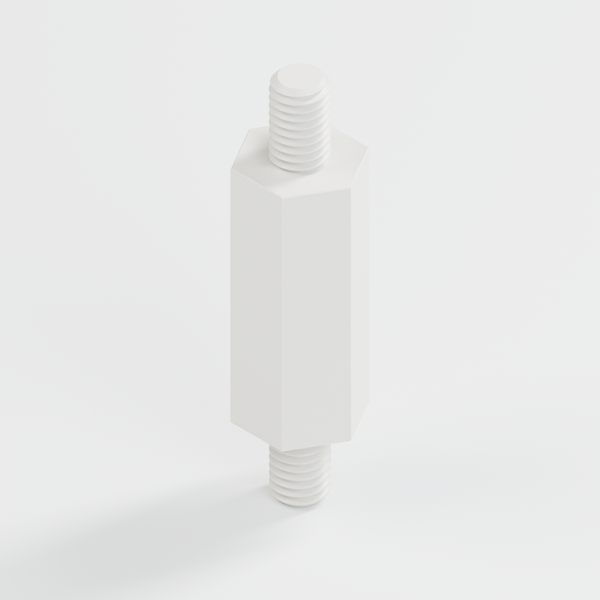
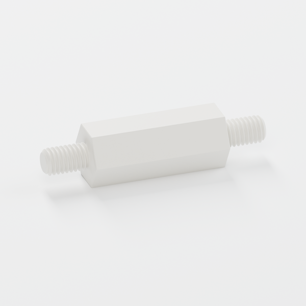
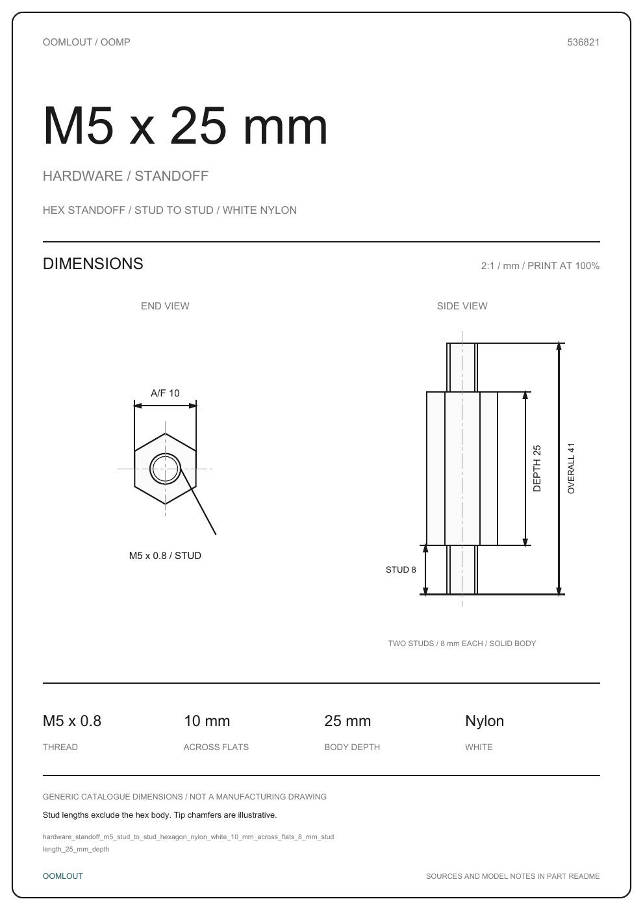

<!-- hardware-part:start -->
# M5 x 25 mm stud to stud hex standoff

## Summary

White nylon spacing hardware for M5 assemblies.

[Catalogue overview](../../README.md) | [Browse family](../../navigation_oobb/hardware/standoff/README.md)

<a href="three_d_model/readme_isometric.png"></a>
<a href="three_d_model/readme_product.png"></a>
<a href="working_mechanical_drawing.png"></a>

Blender/Cycles reference renders from the saved CAD geometry; not product photographs.

## Details

**OOMP ID:** `hardware_standoff_m5_stud_to_stud_hexagon_nylon_white_10_mm_across_flats_8_mm_stud_length_25_mm_depth`

**Taxonomy:** hardware / standoff / m5 / stud_to_stud / hexagon / nylon_white / 10_mm_across_flats / 8_mm_stud_length / 25_mm_depth

| Dimension | Value |
| --- | --- |
| Body depth | 25 mm |
| Material / colour | Nylon / white |
| Thread, both ends | M5 x 0.8 |
| Across flats | 10 mm |
| Connection | stud_to_stud |
| Modelled thread construction | external_only |
| Stud length, each | 8 mm |
| Modelled tapped depth | 0 mm |
| Overall length | 41 mm |


**Model basis:** Generic catalogue dimensions; not a manufacturer-specific drawing. Model uses two 8 mm M5 x 0.8 studs and a solid hex body. The depth range is a catalogue extension; exact all-nylon supplier availability is not verified for every depth.

Small edge chamfers and material appearance are illustrative. Dimensions are nominal, with no supplier tolerances assigned. The full standoff mesh includes a helical basic thread; the display mesh uses smooth tapped bores and studs.

Source evidence checked 2026-11-17:

- [Vital Parts natural nylon hex standoff family](https://www.vital-parts.co.uk/threaded-hex-standoffs-male-female/54853-hmf-m25-8-s5-ny-n): Lists M2.5 with 5 mm flats, an 8 mm stud and 6 mm tapping at 8 mm body depth; the related-product table lists M5 with 10 mm flats, an 8 mm stud and 10 mm tapping at 35 mm body depth. Supports these body-width/stud choices and natural nylon finish. The common depth range, through-tapped version and two-stud version here are generic catalogue extensions, not matched SKUs.
- [Pencom metric hex standoff thread tables](https://www.pencomsf.com/site/assets/product-catalogs/standoffs/hmf-hex-male-female-standoffs-catalog.pdf): Documents metric standoff thread pitches M2.5 x 0.45, M4 x 0.7, M5 x 0.8 and M6 x 1.0. Used for thread-pitch evidence only; body flats, studs and tapping depths follow the separately cited nylon examples.

## Parts

- [OOMP metadata](working.yaml)
- [Dimensioned SVG](working_mechanical_drawing.svg)
- [A4 dimensioned PDF](working_mechanical_drawing.pdf)
- [Drawer label SVG](label_oomp.svg)
- [Editable OpenSCAD](scad/working.scad)
- [OpenSCAD STL](scad/working.stl)
- [Full STL](three_d_model/model_full.stl)
- [Display STL](three_d_model/model_display.stl)
- [Full GLB](three_d_model/model_full.glb)
- [Display GLB](three_d_model/model_display.glb)
- [Blender studio scene](three_d_model/studio.blend)
- [Editable model recipe](three_d_model/parameters.json)
- [Per-part model rebuild](three_d_model/model.py)
- [Model assumptions](three_d_model/model_notes.md)
- [Lighting and render provenance](three_d_model/render_scene.json)

These formats describe the same part. STL/SCAD units are millimetres; GLB units are metres with Y up. The [part folder](./) contains all generated assets.

<details>
<summary>Complete OOMP metadata</summary>

```yaml
across_flats_mm: 10
colour: white
connection_type: stud_to_stud
depth_mm: 25
dimension_note: Model uses two 8 mm M5 x 0.8 studs and a solid hex body. The depth
  range is a catalogue extension; exact all-nylon supplier availability is not verified
  for every depth.
dimension_status: Generic catalogue dimensions; not a manufacturer-specific drawing.
material: nylon
nominal_size: m5
oobb_details:
  across_flats_mm: 10
  angular_segments: 96
  bore_mm: 3.2
  characteristic_dimension_basis: Maximum overall length or nominal outside width
  characteristic_dimension_mm: 41
  connection_type: stud_to_stud
  depth_mm: 25
  edge_chamfer_mm: 0.12
  family: standoff
  finish: nylon_white
  mouth_chamfer_mm: 0.2
  oobb_name: standoff
  oobb_type: standoff
  outer_diameter_mm: 7
  overall_length_mm: 41
  run_scad: true
  run_solidcraft: false
  samples_per_pitch: 16
  specification: Generic catalogue geometry
  stud_length_mm: 8
  tapped_depth_mm: 0
  thread_model: external_only
  thread_nominal_diameter_mm: 5
  thread_pitch_mm: 0.8
oobb_type: standoff
overall_length_mm: 41
shape: hexagon
source_refs:
- vital_standoff_m2_5_m5
- pencom_metric_standoff_threads
stud_length_mm: 8
svg_details:
  accent: '#245b61'
  dimension_font_mm: 3.2
  filename: working_mechanical_drawing
  font_family: DejaVu Sans
  ink: '#1a1a1a'
  line_width_mm: 0.45
  muted: '#777777'
  sheet_height_mm: 297
  sheet_width_mm: 210
  svg_name: spacer_standoff_drawing
  view_scale: 2
tapped_depth_mm: 0
taxonomy_1: hardware
taxonomy_10: ''
taxonomy_11: ''
taxonomy_12: ''
taxonomy_13: ''
taxonomy_14: ''
taxonomy_15: ''
taxonomy_2: standoff
taxonomy_3: m5
taxonomy_4: stud_to_stud
taxonomy_5: hexagon
taxonomy_6: nylon_white
taxonomy_7: 10_mm_across_flats
taxonomy_8: 8_mm_stud_length
taxonomy_9: 25_mm_depth
thread: M5 x 0.8
thread_model: external_only
thread_nominal_diameter_mm: 5
thread_pitch_mm: 0.8
threaded: true
three_d_model:
  generator: spacer_model_geometry
  material:
    base_colour_srgb:
    - 0.86
    - 0.85
    - 0.81
    coat_roughness: 0.28
    coat_weight: 0.025
    metallic: 0.0
    microtexture_height_um: 0.4
    microtexture_spacing_mm: 0.025
    name: Natural white nylon
    note: Visual natural nylon approximation; exact polymer grade and mould surface
      not supplied by catalogue.
    roughness: 0.38
    roughness_variation: 0.025
  notes:
  - Generic catalogue dimensions; not a manufacturer-specific drawing.
  - Model uses two 8 mm M5 x 0.8 studs and a solid hex body. The depth range is a
    catalogue extension; exact all-nylon supplier availability is not verified for
    every depth.
  - Small edge and mouth chamfers are illustrative assumptions, not measured supplier
    features.
  - Full standoff models have helical basic M5 profiles; display models use smooth
    minor-diameter tapped bores and major-diameter studs.
  - STL is in millimetres. GLB is in metres with Y up. OpenSCAD is in millimetres.
  parameters:
    across_flats_mm: 10
    angular_segments: 96
    bore_mm: 3.2
    characteristic_dimension_basis: Maximum overall length or nominal outside width
    characteristic_dimension_mm: 41
    connection_type: stud_to_stud
    depth_mm: 25
    edge_chamfer_mm: 0.12
    family: standoff
    finish: nylon_white
    mouth_chamfer_mm: 0.2
    outer_diameter_mm: 7
    overall_length_mm: 41
    samples_per_pitch: 16
    specification: Generic catalogue geometry
    stud_length_mm: 8
    tapped_depth_mm: 0
    thread_model: external_only
    thread_nominal_diameter_mm: 5
    thread_pitch_mm: 0.8
  renders:
    high:
      file: render_high.png
      pixels: 1600
      variant: full
      view: isometric
    low:
      file: render_low.png
      pixels: 512
      variant: display
      view: isometric
    product_high:
      file: render_product_high.png
      pixels: 1600
      variant: full
      view: product
    product_low:
      file: render_product_low.png
      pixels: 512
      variant: display
      view: product
  schema_version: 1
  studio:
    adaptive_threshold: 0.015
    denoise: true
    device: auto
    engine: cycles
    exposure: 0.0
    floor_colour_srgb:
    - 0.93
    - 0.935
    - 0.94
    floor_roughness: 0.55
    framing_margin: 0.13
    high_samples: 96
    lights:
    - colour:
      - 1.0
      - 0.96
      - 0.9
      height: 5.0
      name: Key softbox
      position:
      - -3
      - -4
      - 6
      power: 650.0
      width: 4.0
    - colour:
      - 0.9
      - 0.95
      - 1.0
      height: 4.0
      name: Fill softbox
      position:
      - 4
      - -1
      - 3
      power: 330.0
      width: 3.0
    - colour:
      - 1.0
      - 1.0
      - 1.0
      height: 5.0
      name: Rim strip
      position:
      - 1
      - 4
      - 4
      power: 850.0
      width: 1.2
    look: AgX - Medium High Contrast
    low_samples: 48
    poses:
      isometric:
        camera_eye:
        - 1
        - -1
        - 1
        orientation: principal axis Z up
        projection: orthographic
      product:
        camera_eye:
        - -6
        - -10
        - 6
        orientation: lying on side, axial end to left
        projection: orthographic
        resting_axis: side
        support: Stable convex-hull support using actual mesh centre of mass.
        yaw_degrees: -12.0
    seed: 7991
    view_transform: AgX
    world_colour:
    - 0.78
    - 0.82
    - 0.9
    world_strength: 0.35
taxonomy_1_upper: HARDWARE
taxonomy_1_upper_length_1: H
taxonomy_1_upper_length_2: HA
taxonomy_1_upper_length_3: HAR
taxonomy_1_upper_length_4: HARD
taxonomy_1_upper_length_5: HARDW
taxonomy_1_length_1: h
taxonomy_1_length_2: ha
taxonomy_1_length_3: har
taxonomy_1_length_4: hard
taxonomy_1_length_5: hardw
taxonomy_1_capital: Hardware
taxonomy_1_first_letter: h
taxonomy_1_first_letter_upper: H
taxonomy_2_upper: STANDOFF
taxonomy_2_upper_length_1: S
taxonomy_2_upper_length_2: ST
taxonomy_2_upper_length_3: STA
taxonomy_2_upper_length_4: STAN
taxonomy_2_upper_length_5: STAND
taxonomy_2_length_1: s
taxonomy_2_length_2: st
taxonomy_2_length_3: sta
taxonomy_2_length_4: stan
taxonomy_2_length_5: stand
taxonomy_2_capital: Standoff
taxonomy_2_first_letter: s
taxonomy_2_first_letter_upper: S
taxonomy_3_upper: M5
taxonomy_3_upper_length_1: M
taxonomy_3_upper_length_2: M5
taxonomy_3_upper_length_3: M5
taxonomy_3_upper_length_4: M5
taxonomy_3_upper_length_5: M5
taxonomy_3_length_1: m
taxonomy_3_length_2: m5
taxonomy_3_length_3: m5
taxonomy_3_length_4: m5
taxonomy_3_length_5: m5
taxonomy_3_capital: M5
taxonomy_3_first_letter: m
taxonomy_3_first_letter_upper: M
taxonomy_4_upper: STUD_TO_STUD
taxonomy_4_upper_length_1: S
taxonomy_4_upper_length_2: ST
taxonomy_4_upper_length_3: STU
taxonomy_4_upper_length_4: STUD
taxonomy_4_upper_length_5: STUD_
taxonomy_4_length_1: s
taxonomy_4_length_2: st
taxonomy_4_length_3: stu
taxonomy_4_length_4: stud
taxonomy_4_length_5: stud_
taxonomy_4_capital: Stud To Stud
taxonomy_4_first_letter: s
taxonomy_4_first_letter_upper: S
taxonomy_5_upper: HEXAGON
taxonomy_5_upper_length_1: H
taxonomy_5_upper_length_2: HE
taxonomy_5_upper_length_3: HEX
taxonomy_5_upper_length_4: HEXA
taxonomy_5_upper_length_5: HEXAG
taxonomy_5_length_1: h
taxonomy_5_length_2: he
taxonomy_5_length_3: hex
taxonomy_5_length_4: hexa
taxonomy_5_length_5: hexag
taxonomy_5_capital: Hexagon
taxonomy_5_first_letter: h
taxonomy_5_first_letter_upper: H
taxonomy_6_upper: NYLON_WHITE
taxonomy_6_upper_length_1: N
taxonomy_6_upper_length_2: NY
taxonomy_6_upper_length_3: NYL
taxonomy_6_upper_length_4: NYLO
taxonomy_6_upper_length_5: NYLON
taxonomy_6_length_1: n
taxonomy_6_length_2: ny
taxonomy_6_length_3: nyl
taxonomy_6_length_4: nylo
taxonomy_6_length_5: nylon
taxonomy_6_capital: Nylon White
taxonomy_6_first_letter: n
taxonomy_6_first_letter_upper: N
taxonomy_7_upper: 10_MM_ACROSS_FLATS
taxonomy_7_upper_length_1: '1'
taxonomy_7_upper_length_2: '10'
taxonomy_7_upper_length_3: '10_'
taxonomy_7_upper_length_4: 10_M
taxonomy_7_upper_length_5: 10_MM
taxonomy_7_length_1: '1'
taxonomy_7_length_2: '10'
taxonomy_7_length_3: '10_'
taxonomy_7_length_4: 10_m
taxonomy_7_length_5: 10_mm
taxonomy_7_capital: 10 mm Across Flats
taxonomy_7_first_letter: '1'
taxonomy_7_first_letter_upper: '1'
taxonomy_8_upper: 8_MM_STUD_LENGTH
taxonomy_8_upper_length_1: '8'
taxonomy_8_upper_length_2: '8_'
taxonomy_8_upper_length_3: 8_M
taxonomy_8_upper_length_4: 8_MM
taxonomy_8_upper_length_5: 8_MM_
taxonomy_8_length_1: '8'
taxonomy_8_length_2: '8_'
taxonomy_8_length_3: 8_m
taxonomy_8_length_4: 8_mm
taxonomy_8_length_5: 8_mm_
taxonomy_8_capital: 8 mm Stud Length
taxonomy_8_first_letter: '8'
taxonomy_8_first_letter_upper: '8'
taxonomy_9_upper: 25_MM_DEPTH
taxonomy_9_upper_length_1: '2'
taxonomy_9_upper_length_2: '25'
taxonomy_9_upper_length_3: '25_'
taxonomy_9_upper_length_4: 25_M
taxonomy_9_upper_length_5: 25_MM
taxonomy_9_length_1: '2'
taxonomy_9_length_2: '25'
taxonomy_9_length_3: '25_'
taxonomy_9_length_4: 25_m
taxonomy_9_length_5: 25_mm
taxonomy_9_capital: 25 mm Depth
taxonomy_9_first_letter: '2'
taxonomy_9_first_letter_upper: '2'
id: hardware_standoff_m5_stud_to_stud_hexagon_nylon_white_10_mm_across_flats_8_mm_stud_length_25_mm_depth
id_no_class: hardware_standoff_m5_stud_to_stud_hexagon_nylon_white_10_mm_across_flats_8_mm_stud_length_25_mm_depth
id_no_type: hardware_standoff_m5_stud_to_stud_hexagon_nylon_white_10_mm_across_flats_8_mm_stud_length_25_mm_depth
id_no_size: hardware_standoff_m5_stud_to_stud_hexagon_nylon_white_10_mm_across_flats_8_mm_stud_length_25_mm_depth
oomp_key: oomp_hardware_standoff_m5_stud_to_stud_hexagon_nylon_white_10_mm_across_flats_8_mm_stud_length_25_mm_depth
link_github: https://github.com/oomlout/oomp_hardware_spacer_standoff_version_5/tree/main/parts/hardware_standoff_m5_stud_to_stud_hexagon_nylon_white_10_mm_across_flats_8_mm_stud_length_25_mm_depth
link_main: https://github.com/oomlout/oomp_hardware_spacer_standoff_version_5/tree/main/parts/hardware_standoff_m5_stud_to_stud_hexagon_nylon_white_10_mm_across_flats_8_mm_stud_length_25_mm_depth
link_redirect: https://github.com/oomlout/oomp_hardware_spacer_standoff_version_5/tree/main/parts/hardware_standoff_m5_stud_to_stud_hexagon_nylon_white_10_mm_across_flats_8_mm_stud_length_25_mm_depth
directory: parts/hardware_standoff_m5_stud_to_stud_hexagon_nylon_white_10_mm_across_flats_8_mm_stud_length_25_mm_depth
name: hardware_standoff_m5_stud_to_stud_hexagon_nylon_white_10_mm_across_flats_8_mm_stud_length_25_mm_depth
name_no_class: Hardware Standoff M5 Stud To Stud Hexagon Nylon White 10 Mm Across
  Flats 8 Mm Stud Length 25 Mm Depth
name_no_type: Hardware Standoff M5 Stud To Stud Hexagon Nylon White 10 Mm Across Flats
  8 Mm Stud Length 25 Mm Depth
name_no_size: Hardware Standoff M5 Stud To Stud Hexagon Nylon White 10 Mm Across Flats
  8 Mm Stud Length 25 Mm Depth
md5: 536821d87eb0320e3b91f57acece80b3
md5_5: '53682'
md5_5_upper: '53682'
md5_6: '536821'
md5_6_upper: '536821'
md5_6_alpha: 395pd
md5_6_alpha_upper: 395PD
md5_10: 536821d87e
md5_10_upper: 536821D87E
bip_39_full_array:
- fat
- donate
- invite
- word
- add
- alpha
- unusual
- dirt
- kiss
- island
- parent
- grit
bip_39_full_space: fat donate invite word add alpha unusual dirt kiss island parent
  grit
bip_39_full_no_space: fatdonateinvitewordaddalphaunusualdirtkissislandparentgrit
bip_39_full_underscore: fat_donate_invite_word_add_alpha_unusual_dirt_kiss_island_parent_grit
bip_39_2_word_array:
- fat
- donate
bip_39_2_word_space: fat donate
bip_39_2_word_no_space: fatdonate
bip_39_2_word_underscore: fat_donate
bip_39_3_word_array:
- fat
- donate
- invite
bip_39_3_word_space: fat donate invite
bip_39_3_word_no_space: fatdonateinvite
bip_39_3_word_underscore: fat_donate_invite
name_space: hardware standoff m5 stud to stud hexagon nylon white 10 mm across flats
  8 mm stud length 25 mm depth
name_proper: Hardware Standoff M5 Stud To Stud Hexagon Nylon White 10 Mm Across Flats
  8 Mm Stud Length 25 Mm Depth
```

</details>

## Assembly

Select the depth required by the assembly. Match the nominal screw size and check the purchased part's actual clearance or usable thread engagement. No tested assembly procedure or tightening torque has been established for this generic record.
<!-- hardware-part:end -->
